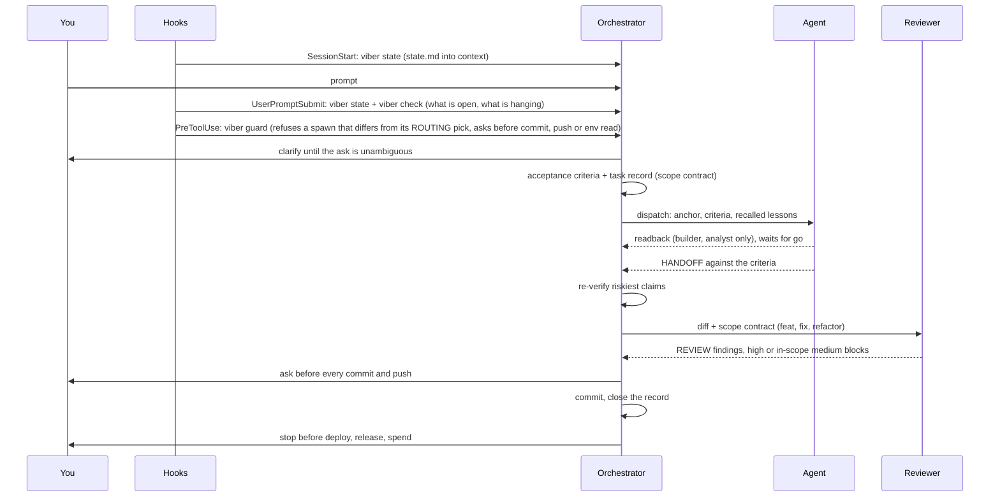
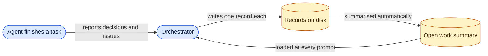
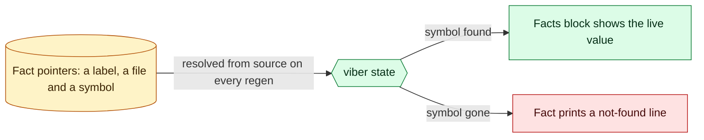

# viber

A harness for Claude Code. You talk; one orchestrator runs the loop. It clarifies the ask, writes the acceptance criteria, hands each piece to the agent whose model fits it, audits the handoff, sends every code change through a reviewer, commits, and stops for you before anything hard to undo. It also runs the CLI that keeps memory current; you never type a viber command.

Stdlib Python 3.8+ for the CLI. Node 22.12+ only if you use device-testing (it starts agent-device through npx).

## Why this exists

This is my personal harness. I use it to build the apps on [dangnguyen.app](https://dangnguyen.app), and to run Claude as my day-to-day assistant.

Context, memory, reviews, model routing: plenty of repos already handle each of these. They do it one piece at a time, though, and stacking them never fit how I work. For someone new it is overwhelming. You have probably read a "30 plugins you need for Claude Code" post by now.

You do not need to install anything, at least not at first. Use Claude Code as it is until you hit a real problem in the way you work, then find the fix for that problem. Do not collect fixes for problems you do not have yet.

So everything here is something I wrote to fix a problem I actually hit, and it keeps changing as I keep building.

## One session



## What's in it

Everything lives in `template/`. `viber upgrade` puts it into your project and keeps it current.

| Part | Path | What it is |
|---|---|---|
| Rules | `CLAUDE.md` | The orchestrator's contract, kept short: roles, the work loop, routing table, reporting, git rules, and a "Read on demand" table naming which rules file or skill to read before which kind of work. Your own rules go below its last line, the marker. `AGENTS.md` points at it so other tools read the same file. |
| Rules on demand | `.viber/docs/rules/*.md` | The detail CLAUDE.md points at, read only when that work comes up: `memory.md` (record CLI and rules), `truth.md` (plans), `learning.md` (signals, lessons, remedies), `review-gate.md` (accepting a handoff, the review gate). Each binds as if written in CLAUDE.md. |
| Agents | `.claude/agents/*.md` | Six definitions, one per kind of work, each with a default model: `analyst` (opus), `builder` (opus), `coder` (sonnet), `grunt` (haiku), `reviewer` (sonnet), `runner` (haiku, executes a written test or capture plan and returns artifacts, never a verdict). |
| Hooks | `.claude/settings.json` | `SessionStart` loads memory into context and, after a compaction, lists the rules files to read again and the newest saved agent reports; `SubagentStop` saves each agent's final report to `.viber/handoffs/` (never committed, kept 30 days, at most 200); `UserPromptSubmit` reloads memory and lists what is hanging; `PreToolUse` runs the guard on every spawn, command and edit. |
| Skills | `.claude/skills/` | Rule sets that load only when the work matches. See "Skills that ship with viber". |
| Device server | `.mcp.json` | Declares `agent-device` (pinned) so agents can drive a phone, simulator or emulator. For mobile work only: delete the file if you do not build apps. |
| CLI | `.viber/bin/viber` | One Python file the orchestrator runs: records, facts, lessons, findings, signals, code graph, guard, health report, upgrade. |
| Version | `.viber/template.lock` | Which viber version the project has and what each viber file looked like when it was installed, written by `viber upgrade`. It holds no local path. Commit it; never edit it. |
| Memory | `.viber/memory/records/` | One file per record: `decision`, `task`, `issue`, `lesson`, `milestone`, `question`, `fact`. `state.md` and `index.md` are generated from them. The open count in `state.md` counts only real work (`task`, `issue`, `question`), so decisions, lessons and facts never inflate it. A `fact` record points at a source symbol; `viber state` resolves it live into its Facts block. That block is what is true about the project now. There is no authored truth file. |

## Problem, and what viber does about it

| Pain | Mechanism |
|---|---|
| The agent says "done" and it is not | Acceptance criteria are written before dispatch, by the orchestrator, not the agent. The agent reports against them in a `HANDOFF:` block; the orchestrator re-runs the riskiest claims itself before accepting. |
| Hard work goes to a cheap model, trivial work to an expensive one | Four routing questions pick the agent (the kind of work); five more pick the model for each spawn, starting from the agent's default and moving at most one tier in total. Effort is chosen per spawn too, never below medium. A decided brief goes to `coder`, an open question to `builder`. Each spawn carries its answers in one `ROUTING:` line; the guard computes the agent, model and effort from them (`viber route`) and refuses a spawn that differs, and a definition with no model line is reported every prompt. |
| Context is lost between sessions | Decisions, tasks, lessons and issues are records on disk. The session-start hook regenerates them into the first prompt. |
| Numbers in memory go stale | A fact is stored as a location (`file` + `symbol`), never as a value; state resolves it from source on every regen. |
| Docs drift from code | There is no hand-written statement of what is true now. The Facts block in `viber state` is generated from `fact` pointers (`file` + `symbol`) and resolved from source on every regen, so it cannot silently rot. A pointer whose symbol is gone prints a loud not-found line instead of an old value. Records hold only why, intent and lessons. |
| The same mistake repeats | Owner rejections, spec gaps, dead ends, surprises and escaped bugs are raised as signals; reopened work and returning defects are raised by the CLI itself. Each is an open record nagged every turn until closed. A signal worth keeping becomes a lesson scoped to an agent and a topic, and the orchestrator recalls those lessons into every dispatch. A lesson naming a file that no longer exists is flagged stale at recall. |
| A scope claim is a grep guess | `viber graph deps` walks imports (`.ts .tsx .js .jsx .dart .py .gd`) and prints a coverage line saying how many files it parsed, so "no other callers" is a measured claim or an admitted blind spot. |
| Code commits nobody read | A `feat`, `fix` or `refactor` commit waits for a fresh `reviewer` to read the diff against a scope contract (anchor, base commit, file globs, criteria). Any high or in-scope medium finding blocks. Two rounds at most, then the orchestrator decides. |
| Findings get fixed on the surface and come back | Each recorded finding is fingerprinted by file and problem; a second sighting raises a repeat signal instead of a fresh record. |
| Parallel agents clobber each other | Concurrent agents get disjoint file scopes and their own scratch prefix, prove only their own change, and the project suite runs once over the union after all have landed. |
| A subagent burns budget waiting | Rules and agent definitions forbid `sleep` polling: long jobs run in the background, raw output goes to a file. |
| Secrets slip into a commit | Every prompt reports lines that look like a live credential. The guard asks before any env-file read and before any commit or push; the orchestrator never deletes or unstages on its own. |
| A subagent commits, or one project edits another | The guard refuses a commit or push from a subagent, and any edit or commit that lands in a different project's repo. |
| A command breaks code signing | The guard asks you before any `security` command that changes a macOS keychain or a system security setting: adding, deleting or importing an item, unlocking, changing a partition list, the search list or the default keychain, trust settings. Reading one passes. |
| The harness itself rots | A dead hook, a missing agent file, invalid `settings.json`, duplicate record ids, or a `state.md` older than its records is reported at the top of every prompt. |
| Each project's copy drifts from the others | `viber upgrade` brings any number of projects to the current template in one command, and never overwrites a local edit without `--force`. `viber doctor` prints the version a project has and what changed since. |

## Where the data goes

Three loops run in the background. Blue is who acts, yellow is what is stored on disk, green is a check.

**Memory: nothing is forgotten between sessions**



**Learning: a mistake is not made twice**

```mermaid
flowchart LR
    M([Something goes wrong]) -->|rejected work, spec gap, dead end, bug that came back| G{{Open signal}}
    G -->|nagged every prompt until handled| O([Orchestrator])
    O -->|turns it into a lesson for one agent and topic| L[(Lessons)]
    L -->|pasted into the next brief for that agent| A([Agent])
    classDef actor fill:#dbeafe,stroke:#1d4ed8,color:#0b1b3f
    classDef store fill:#fef3c7,stroke:#b45309,color:#3b2303
    classDef check fill:#dcfce7,stroke:#15803d,color:#052e16
    class M,O,A actor
    class L store
    class G check
```



**Facts: what is true now is read from the code, not written down**



## Install

```bash
git clone https://github.com/dangnhh92/viber-harness viber
mkdir my-project
python3 viber/template/.viber/bin/viber upgrade my-project --apply
cd my-project
python3 .viber/bin/viber init
```

`upgrade` installs into an empty folder. `init` creates `.viber/memory/records/`, `.viber/docs/`, `src/` and generates `state.md`. These are the only commands you run yourself.

`upgrade` refuses a folder that has files but no viber, so it never overwrites an existing project. To add viber to one, install into an empty folder and move the files over by hand.

## Update

```bash
git -C viber pull
python3 viber/template/.viber/bin/viber upgrade my-project other-project
python3 viber/template/.viber/bin/viber upgrade my-project other-project --apply
```

Run it from the viber checkout. Pass several projects to get a summary table.

| Flag | What it does |
|---|---|
| none | Dry run: lists what it would add, update, remove, skip or keep out, and writes nothing. |
| `--apply` | Writes the changes and stamps `.viber/template.lock`. Refuses when the viber checkout has uncommitted template changes, because the stamp would name no commit. |
| `--force <path>` | Overwrites one file you edited, or brings back one you deleted. The path is relative to the project. Repeat it for more files. |
| `--diff` | Prints the whole diff for each `SKIP`, not only its first lines. |
| `--allow-dirty` | With `--apply`, applies a template that has uncommitted changes anyway. |

`CLAUDE.md` ends with this marker line:

```
<!-- viber: project rules go below this line; upgrade keeps them -->
```

Everything above it is viber's and gets replaced. Everything below it is yours and is kept. A `CLAUDE.md` without the marker gets it on the first upgrade, placed before the first section viber never had.

- It replaces what viber owns: the CLI, rules, agents, skills, `AGENTS.md`, `CLAUDE.md` above the marker line, viber's hooks in `settings.json` and viber's servers in `.mcp.json`.
- It never touches your memory, code, other hooks, other settings, other servers, or `CLAUDE.md` below the marker.
- A viber file you edited is a `SKIP`: it shows your own lines and a diff, and leaves the file alone. `--force <path>` overwrites it.
- A viber file you deleted stays deleted, unless you pass `--force <path>`. On the first upgrade there is no record of what you deleted, so a missing file counts as deleted when viber had it before viber came into your project: the first commit under `.viber/`, or the repo's first commit when `.viber/` is there but was never committed. A file viber added later is installed. A fresh install, a repo with no committed files, and a project without git history get every missing file.
- A project copied in before `upgrade` existed works too: files that match any earlier viber version count as unedited.

Best practice: keep your own rules below the `CLAUDE.md` marker and in your own skills, never inside viber's files. Then every update is clean. `viber version` prints the version a project has.

## Recommended workflow

Open the project in Claude Code and talk. This is what to expect.

1. **Say what you want in plain words.** It asks until the ask is unambiguous: what good looks like, what is out of scope, any hard constraint. Answer those; they become the criteria it checks against.
2. **It writes the acceptance criteria and opens a task record.** For a code change the record is the scope contract: anchor, base commit, file globs, criteria.
3. **It routes and dispatches.** Analysis and documents to `analyst`, code that still needs a design decision to `builder`, decided code of any size to `coder`, bulk mechanical edits to `grunt`, a written test or capture plan to `runner`. Lessons for that agent and topic go in with the brief. `builder` and `analyst` first read the task back in four lines and wait for a go.
4. **It audits the handoff.** Riskiest "met" claims get re-run; an incomplete handoff goes back to the same agent.
5. **It reviews before committing.** A fresh `reviewer` reads the diff against the contract. Blocking findings go back verbatim to the implementer and are recorded so a recurrence is counted.
6. **It asks, commits and closes the record.** Every commit and push is asked first. It stops for you before anything hard to undo: a push where others can read, a deploy, a release, spending money.

Small work skips the ceremony: a one-line fix is one loop, done by the orchestrator itself, no subagent and no readback, and the review gate still runs if the commit is `feat`, `fix` or `refactor`.

What helps: answer the clarifying questions, let it pick the agent and take its pushback seriously (it is told to disagree out loud).

## Plugins, when you need them

Start with none. When a problem keeps coming back, add the one plugin that fixes it. These are the official-marketplace plugins I ended up adding, each next to the problem that made me add it.

| Problem you hit | Plugin |
|---|---|
| The agent writes code against an old version of a library | `context7` (current library docs) |
| The agent says the UI works but never looked at it | `device-testing` (ships with viber) for phones and simulators; `playwright` for the browser |
| Symbol lookups by grep miss things | the LSP plugin for your stack (`typescript-lsp`, `swift-lsp`) |
| Deploys, databases, designs live in a service | that service's plugin: `vercel`, `firebase`, `supabase`, `github`, `figma`, `railway` |

Leave these off, they fight viber: `superpowers` (its process skills override the clarify step and the routing), `frontend-design` (a second UI rule set beside `designing-interfaces`), `code-review` and `commit-commands` (viber has its own review gate and commit rules).

## Skills that ship with viber

They live in `.claude/skills/` and load only when the work matches.

| Skill | Use it for |
|---|---|
| `designing-interfaces` | Building or reviewing any UI: one pass/fail rule set, data-display rules for dashboards and charts, and a verification checklist |
| `new-app` | Building or shipping a mobile app: rules and a blocking pre-submit checklist from naming to store upload |
| `serving-mobile-ads` | Writing or auditing AdMob loading in an iOS or Android app: load on intent, expiry, retry, consent, measuring show rate |
| `iap-entitlement` | Any code that sells, grants, restores or revokes a purchase or subscription: rules and a required test matrix |
| `device-testing` | Driving and checking an app on a real iPhone, simulator, emulator or browser |
| `writing-copy` | Published prose: store copy, blog posts, app descriptions, so it reads like a person wrote it |
| `harness-audit` | Checking whether the harness itself runs properly, where it wastes tokens, where it has holes |

<details>
<summary>CLI reference (the orchestrator runs these)</summary>

```
viber new <type> "<title>" [--tags a,b] [--body "..."]
viber set <id> <status>                 open | doing | blocked | done | dropped
viber list [--status s] [--type t] [--tag x]
viber show <id>
viber fact "<label>" <file> <symbol>
viber finding <file> "<problem>" [--severity high|medium|low]
viber trigger <kind> "<what happened>"
viber lessons --for <role> [--tags a,b] [--limit 5]
viber graph build | deps <R-042|doc:NAME.md|path::SYMBOL> | orphans
viber check      (runs on every prompt)
viber guard | recompact | handoff   (hooks run these)
viber compactions [--last N]   (by hand: how many summary lines with a number name their source)
viber doctor
viber version
viber upgrade <project>... [--apply] [--force <path>] [--diff] [--allow-dirty]   (run from the viber checkout)
viber state | index | init
```

</details>

